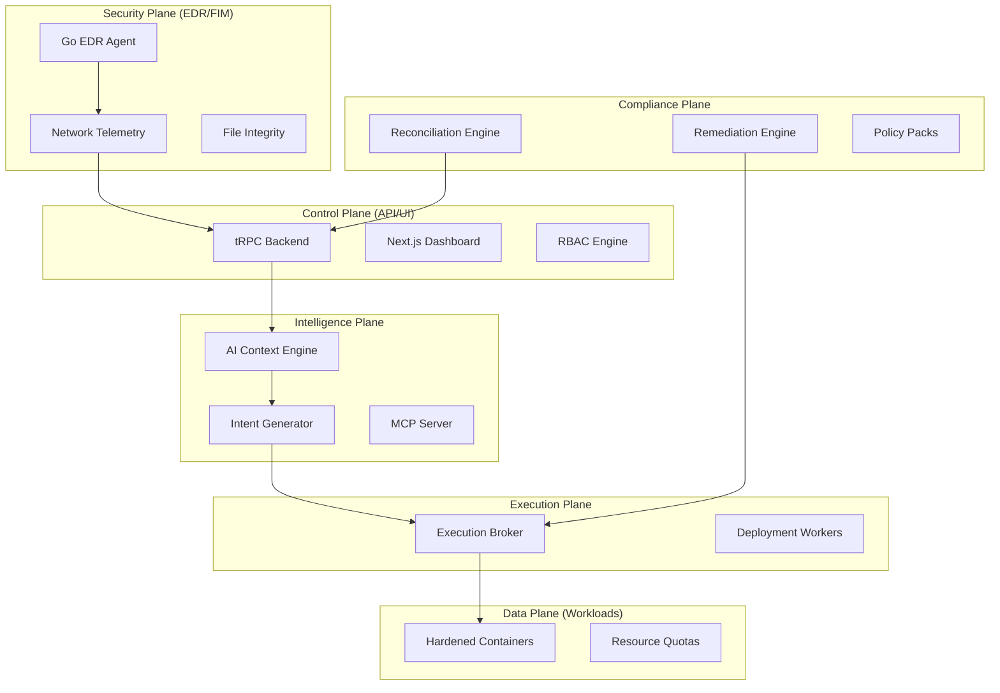

# 🛡️ DBBKP — Distributed Infrastructure Control Plane

DBBKP is a **Secure Infrastructure Operating System** and **Distributed Control Plane** designed to automate orchestration, security hardening, and self-healing deployments across a fleet of heterogeneous nodes.

Unlike traditional hosting panels, DBBKP implements a **Desired State Reconciliation** architecture (similar to Kubernetes) to ensure that your infrastructure, security posture, and runtime workloads are always compliant with your defined policies.

---

## 🏛️ Architecture Overview

The platform is designed around a **multi-plane architecture** that separates control logic from high-risk execution:



---

## 🚀 Feature Classification

| Category | Features |
| :--- | :--- |
| **Core OSS** | Container Deployments, CI/CD Pipelines, Real-time Metrics, Multi-node Dashboard |
| **Advanced OSS** | EDR-lite, FIM, Resource Quotas (PIDs/RAM), WebSocket Terminal, PTY Auditing |
| **Enterprise** | Policy Packs (CIS/PCI), Security Reconciler, Approval Workflows, Compliance Reports |
| **Intelligence** | AI SRE (Auto-healing), AI Security Analyst, Local LLM (Ollama), MCP Tool Server |
| **Managed** | Hosted Control Plane, Multi-cluster Federation, Global Load Balancing |

---

## ⚡ Key Architectural Features

### 🔄 Desired State Reconciliation
The platform continuously monitors the delta between your **Desired State** (defined in the DB) and the **Observed State** (reported by agents).
- **Self-Healing**: Automatically detects crashed site containers and triggers recovery deployments.
- **Security Drift**: Detects manual changes to `sshd_config`, `ufw`, or `authorized_keys` and alerts or auto-remediates based on mode.

### 🛡️ Execution Broker (Zero-Trust Execution)
No infrastructure mutation is trusted implicitly. All shell and Docker actions flow through the **Execution Broker**.
- **Intent-Based Validation**: Requires a structured "Intent" (actor, tenant, command class) before execution.
- **Safety Guards**: Automated pre-flight checks (e.g., `ssh_access` guard) prevent accidental lockout during hardening.
- **Trace Correlation**: Links every low-level command to a specific user request and `traceId`.

### 📦 Hardened Runtime & Quotas
Workloads are isolated using enterprise-grade container policies:
- **Resource Limits**: CPU shares, Memory quotas, and **Fork-Bomb Protection** (`pids-limit`).
- **Security Context**: `no-new-privileges`, non-root execution, and read-only filesystem support.
- **Egress Governance**: Outbound connection tracking and protocol-level risk analysis.

---

## 🔍 Security Plane (EDR & Posture)

DBBKP transforms your infrastructure into a forensically-aware environment:

- **EDR Explorer**: Real-time process ancestry, risk scoring, and behavioral signal detection.
- **File Integrity (FIM)**: Tracks SHA-256 hashes, inodes, and entropy to detect web-shells and persistent malware.
- **Network Telemetry**: Ingests outbound connections and DNS requests to identify C2 callbacks or crypto-pools.
- **Remediation Lifecycle**: A formal `Plan -> Approve -> Execute -> Verify` workflow for all security fixes.

### Security Modes
1. **Monitor**: Detect drift and report anomalies without changing state.
2. **Guided**: Generate remediation plans for admin review and approval.
3. **Enforce**: Automatically restore the security baseline upon drift detection.
4. **Locked**: Strict enforcement of a hardened, immutable security posture.

---

## 🏢 Multi-Tenant Governance
- **RBAC Engine**: Granular permissions (sites, security, infra) with tenant scoping.
- **PTY Session Auditing**: Full recording and keystroke analysis of terminal interactions.
- **Tenant Isolation**: Strict ownership validation ensures users only interact with their own resources.

---

## 🛠️ Technical Stack

- **Backend**: Node.js 22, tRPC, BullMQ (Queueing).
- **Frontend**: Next.js 15, xterm.js, High-performance WebSockets.
- **Security**: Go EDR Agent, Autonomous Bash Scripts.
- **Storage**: PostgreSQL (Drizzle ORM), Redis (Event Bus).
- **Runtime**: Docker Engine, UFW, Systemd.

---

## 🚀 Getting Started

### 1. Install Dependencies
```bash
pnpm install
```

### 2. Configure Environment
Create a `.env` file based on `.env.example`.

### 3. Setup Infrastructure
```bash
pnpm db:generate
pnpm db:migrate
pnpm db:seed
```

### 4. Start Control Plane
```bash
pnpm dev
```

---

## 🏁 Summary

DBBKP is built for organizations that need more than a panel—they need a **Secure Infrastructure Operating System**.

*   **PaaS Capability**: Like Coolify / Dokploy.
*   **Security Automation**: Like EDR / Posture Management.
*   **Self-Healing**: Like Kubernetes.
*   **Unified Visibility**: Like Datadog.

👉 Result: **A unified, secure, and self-healing control plane for distributed infrastructure.**
